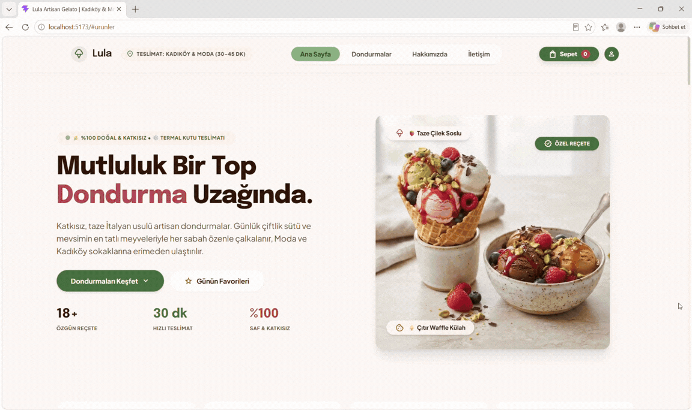

# 🍦 Lula – Ice Cream Shop

Lula is a modern and responsive ice cream shop web application built with React. It offers a delightful shopping experience with an elegant user interface, dynamic product listing, and interactive shopping cart functionality.

## ✨ Features

- Modern and responsive user interface
- Dynamic product listing and category filtering
- Product details and selection options
- Add to cart functionality
- Interactive shopping cart management
- Increase and decrease product quantities
- Remove items from the cart
- Real-time cart total calculation
- Smooth navigation and user-friendly experience

## 🛠️ Technologies

- React
- JavaScript (ES6+)
- Tailwind CSS
- Vite
- Redux Toolkit
- React Redux
- REST API
- HTML5
- CSS3

## 📸 Preview

